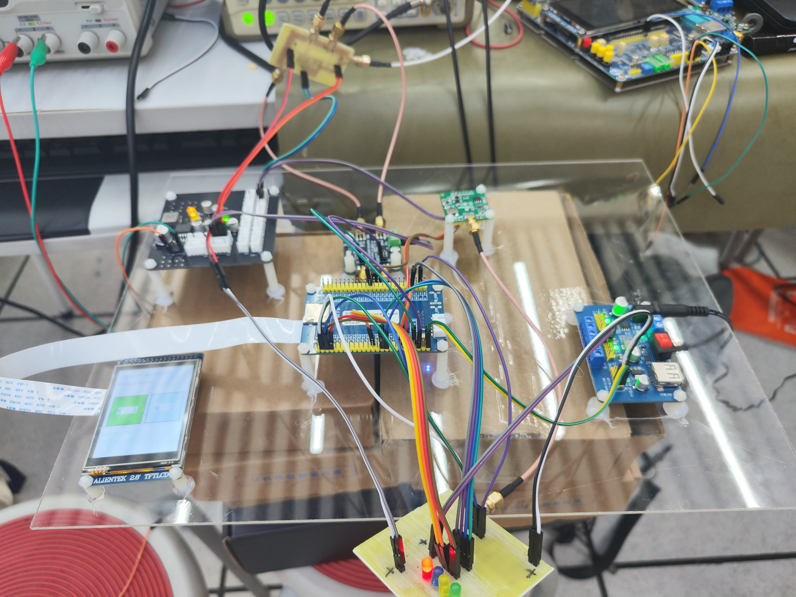
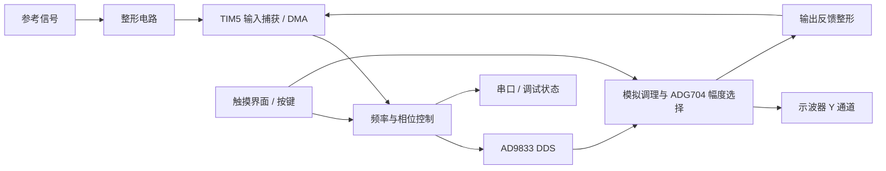
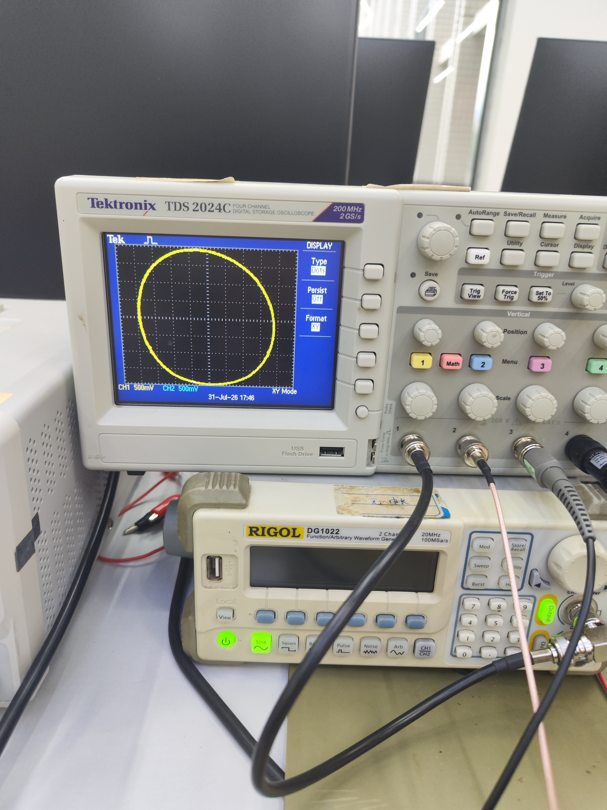
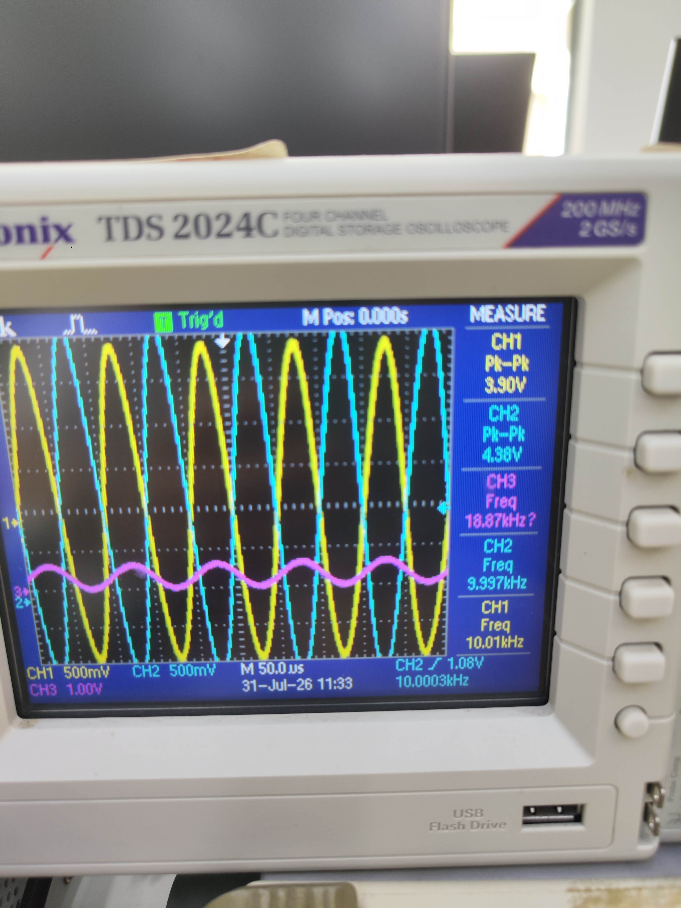
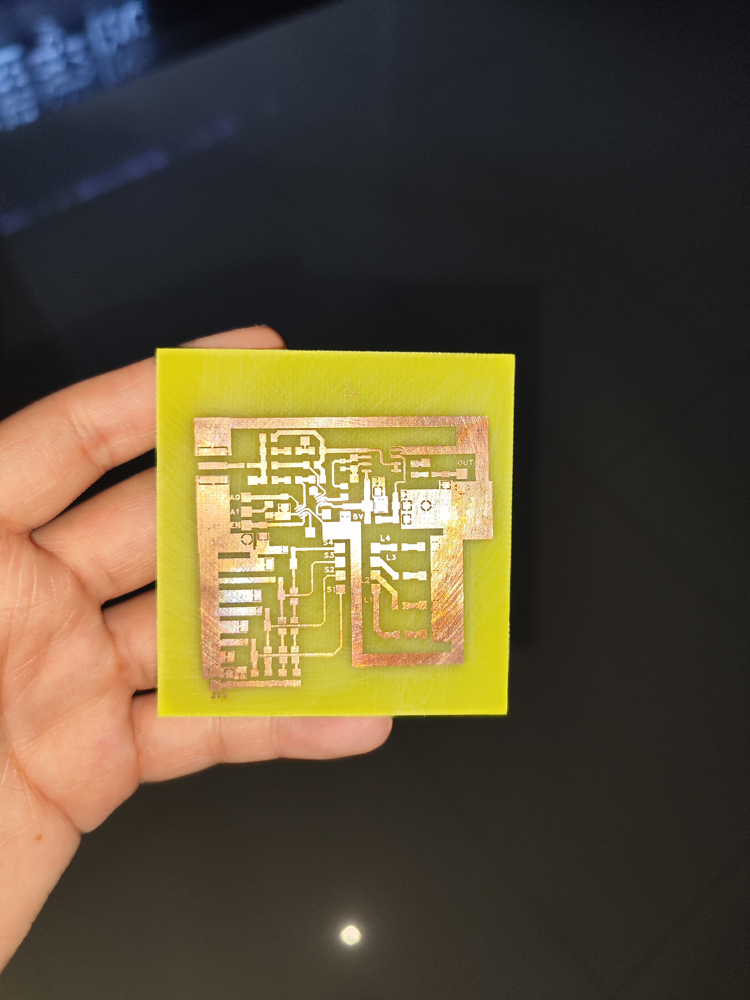

# 李萨如图形控制系统

**STM32F407 · DDS 信号生成 · 频率与相位控制 · 自制硬件**

**2026 年重庆市电子设计大赛 · 三等奖**

从电路设计、板卡制作，到嵌入式程序与示波器联调。

[实物与实验](#实物与实验记录) · [软件导航](#软件导航) · [构建与接线](#构建与接线)

---

## 项目概览

围绕示波器 X-Y 显示构建的信号控制系统。STM32F407 采集参考与反馈信号边沿，控制 AD9833 输出，并通过 ADG704 选择幅度档位。

| 控制核心 | 信号链路 | 交互方式 | 开发工具 |
| :---: | :---: | :---: | :---: |
| STM32F407 | AD9833 + ADG704 | 触摸屏 / 按键 / LED | C · STM32 HAL · Keil · CubeMX |

本人完成硬件设计、制作和系统联调；软件由本人使用 Codex 辅助开发。

## 项目内容

- **信号控制**：AD9833 SPI 驱动，频率控制字与相位寄存器配置。
- **测量与反馈**：TIM5 双通道输入捕获配合 DMA，采集参考和反馈信号边沿。
- **控制模式**：代码提供频率跟随、同频正交、二倍频模式接口；当前主程序以频率跟随模式初始化。
- **幅度控制**：ADG704 四路选择、按键消抖与单档 LED 指示；切换地址前关闭使能，避免瞬态串档。
- **交互与调试**：LCD 触摸界面、串口诊断，以及可在调试器中观察的频率、相位、捕获异常等状态。

本仓库展示实际 MCU 工程与比赛照片。未将放弃的视觉控制方案纳入功能说明；不以历史设计报告中的目标或测试表作为当前工程性能保证。

## 系统结构

上图概括代码涉及的控制链路；最终模拟电路细节以待补充的原理图为准。

## 实物与实验记录

| X-Y 图形实验照片 | 波形调试照片 |
| --- | --- |
|  |  |

X-Y 照片记录了圆/椭圆形轨迹。静态照片用于呈现实验现象，不用于证明长时间锁定性能；波形照片的通道定义和测试条件尚待补充。

### 电路板制作

比赛期间的电路板制作记录。对应模块名称将在最终原理图整理后补充。

## 软件导航

| 文件 | 作用 |
| --- | --- |
| `Core/Src/main.c` | 外设初始化与各模块任务调度 |
| `Core/Src/lissajous_pll.c` | 边沿采集、频率与相位估计、反馈控制 |
| `Core/Inc/lissajous_pll.h` | 控制接口与诊断状态结构 |
| `Core/Src/ad9833.c` | DDS 寄存器与频率、相位控制 |
| `Core/Src/amplitude_panel.c` | 四档幅度选择、按键消抖、LED 指示 |
| `Core/Src/lcd_touch_ui.c` | LCD 触摸交互 |
| `Core/Src/pll_diagnostic_uart.c` | 串口诊断输出 |
| `ADG704.ioc` | CubeMX 外设及引脚配置 |
| `MDK-ARM/ADG704.uvprojx` | Keil 工程入口 |

## 构建与接线

1. 安装 Keil MDK 与适用的 STM32F4 设备支持包。
2. 打开 `MDK-ARM/ADG704.uvprojx`，检查工程所需编译器和设备包，再编译。
3. 按 `ADG704.ioc`、`Core/Inc/main.h` 及最终硬件原理图接线。
4. 下载至匹配的 STM32F407 硬件，结合示波器检查输入整形、DDS 输出和反馈链路。

当前仅完成代码整理与文档核对，尚未在整理后的副本上完成编译和上板复验。模拟输入电压范围、完整供电和接线资料待补充，不能仅凭本页复刻硬件。

已核对的幅度控制引脚：A0/PF0、A1/PF1、EN/PF2；LED1–4/PF3–PF6；KEY1/PF7、KEY2/PF8、KEY3/PG13、KEY4/PG14；DDS FSYNC/PB10。其余接口见工程配置。

## 个人工作与开发方式

本人完成硬件设计、制作和系统联调；软件使用 Codex 辅助开发。工程保留第三方 ST HAL、CMSIS 及 BSP 等依赖，这些依赖不属于本人原创代码。比赛奖项信息由作者提供。

## 后续补充

- 最终原理图及模拟模块说明。
- 各模式操作步骤、典型测试条件与通道定义。
- 实际工具链版本和编译、上板复验记录。

## 与赛前准备仓库的关系

[Active-Filter-Module](https://github.com/ZXY1110101/Active-Filter-Module) 汇集赛前硬件与软件模块准备；本项目是单独的参赛工程，两者分别展示。

## 许可

尚未为本人编写的部分指定开源许可证。第三方依赖遵循各自许可及文件头声明。
